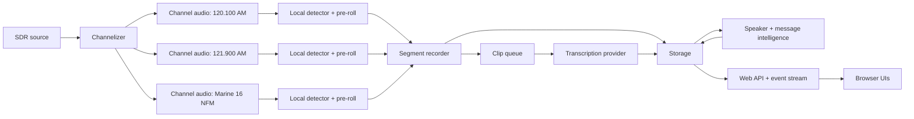

# Architecture

> **Prototype archive.** This page describes the earlier Python prototype. Its commands, paths, release numbers, and plans apply to that implementation. For the Rust application, see the [current documentation](../README.md).

## Summary

A16T should be built around a local detection gate:

1. Capture radio spectrum locally.
2. Split it into configured channels.
3. Demodulate each channel.
4. Detect activity locally.
5. Keep a short ring buffer so the start of a conversation is not clipped.
6. Record only active conversations.
7. Send bounded clips to speech-to-text.
8. Stream activity and transcript events to the UI.

OpenAI currently documents two relevant speech-to-text paths: request-based transcription for bounded audio files, and realtime transcription for transcript deltas from streaming audio. For the cheapest and simplest first version, use request-based transcription for detected clips. Add realtime transcription later as an optional mode that starts only after local activity detection.

References checked 2026-06-13:

- [OpenAI speech to text](https://developers.openai.com/api/docs/guides/speech-to-text)
- [OpenAI realtime transcription](https://developers.openai.com/api/docs/guides/realtime-transcription)
- [OpenAI audio overview](https://developers.openai.com/api/docs/guides/audio)

## High-Level Flow



## Proposed Boundaries

The architecture should use boundaries as a design rule. A boundary is the contract between modules: what data enters, what events leave, and what dependencies are allowed inside. Boundaries should make the app easier to test and easier to change, without splitting the proof of concept into many services.

Good boundary rules:

- Lower-level modules should not import higher-level modules.
- Hardware and paid APIs need fake, replay, or null implementations.
- Configuration should cross boundaries as profile/settings data, not as global constants.
- Events should describe facts, not UI commands.
- Storage should persist domain records, not internal objects from GNU Radio, OpenAI, or browser code.

### Radio Engine

Owns hardware capture, channelization, and demodulation. It should not know about airports, marine channels, OpenAI, browser UI, or SQLite details.

Responsibilities:

- Start and stop SDR capture.
- Tune one or more capture windows.
- Downconvert configured channels.
- Demodulate each channel based on profile modulation.
- Emit normalized mono audio frames per channel.
- Capture short receive-only radio-stream fixtures for later validation.
- Validate pre-demodulation radio-stream fixtures against profile capture settings.

The radio engine is replaceable. GNU Radio can remain the most capable live backend for the first RTL-SDR v3 proof of concept, but app code depends on the Python `RadioEngine` interface, not on GNU Radio imports. See [technology-review.md](technology-review.md) for the package and runtime tradeoffs.

The current GNU Radio backend supports AM and narrow FM channel demodulation for the built-in aviation and marine profiles.

### Activity Detector

Owns local decision-making about whether a conversation is happening.

Responsibilities:

- Track per-channel noise floor.
- Detect squelch-open or speech-like activity.
- Maintain a per-channel pre-roll ring buffer.
- Emit `transmission_started`, `audio_frame`, and `transmission_ended` events.
- Apply hang time so short pauses do not split one conversation into many clips.
- Ignore clicks and very short bursts.

Recommended MVP defaults:

- Pre-roll: `0.75s`
- Minimum duration: `0.35s`
- Hang time: `0.8s`
- Max segment duration: `45s`
- Adaptive threshold with profile override

The user's requested extra half-second belongs here. It should be implemented as local pre-roll, not by starting paid transcription early.

### Segment Recorder

Owns durable clip creation.

Responsibilities:

- Create a WAV clip per detected transmission.
- Include pre-roll audio.
- Store start time, end time, peak level, channel id, and clip path.
- Move transmission state from `recording` to `queued` after the clip is durable.
- Emit app events for recording and queueing.

### Transcription

Owns all speech-to-text provider behavior behind a small interface.

MVP mode:

- Send the completed clip to a request-based transcription API.
- Use a radio-domain prompt or vocabulary hint when supported.
- Store the returned text and status.

Future realtime mode:

- When local detection fires, open or resume a realtime transcription session.
- Send buffered pre-roll first, then live audio frames.
- Close the session after hang time.
- Stream partial transcript events to the UI.

The app should make transcription provider, model, and cost mode configurable. OpenAI should be one provider, not a hard-coded dependency spread through the radio pipeline.

### Speaker And Message Intelligence

Owns post-transcription structure: who appears to be talking, what kind of message it is, and how confident the app is.

Responsibilities:

- Extract callsigns, tail numbers, vessel names, station names, and radio roles from transcript text.
- Group aliases that refer to the same participant.
- Classify message type and urgency.
- Preserve confidence and evidence so the UI can show uncertainty honestly.
- Emit updates when a transcript is reprocessed or corrected.

The first version should identify radio participants from self-identification and domain grammar. Audio speaker diarization and voice matching should remain later options because radio audio is narrowband, noisy, and often already divided into push-to-talk turns.

For details and implementation options, see [speaker-message-intelligence.md](speaker-message-intelligence.md).

### Storage

Owns metadata and local clip locations.

Tables or records:

- `profiles`
- `channels`
- `participants`
- `transmissions`
- `transcript_segments`
- `message_classifications`
- `app_events`

SQLite is enough for the first version.

### Web API

Owns the local browser contract.

Endpoints:

- `GET /api/profiles`
- `GET /api/state`
- `GET /api/runtime` for runtime mode, paths, diagnostics checks, and recent app events.
- `GET /api/transmissions` with review filters for window, channel, priority, state, query, and limit.
- `GET /api/transmissions/{id}`
- `PATCH /api/transmissions/{id}` for manual participant/message metadata corrections.
- `GET /clips/{id}.wav`
- `GET /events` using Server-Sent Events

The current browser uses `EventSource` against `GET /events` so active frequencies and lifecycle changes can update without a fixed browser polling loop.

### Browser UIs

The browser should consume events and render the same data through different views:

- Watchboard: current live activity.
- Timeline: history across channels.
- Transcript Review: searchable clips and text.
- Setup: profiles, channels, SDR windows, thresholds, and transcription mode.

## Profiles

Profiles describe the radio domain and keep the engine generic.

Current built-in profiles are JSON files. Minimal example shape:

```json
{
  "id": "iad-airband",
  "label": "IAD Airband",
  "domain": "aviation",
  "transcription_prompt": "Air traffic control radio. Expect callsigns, runway numbers, headings, altitudes, taxiways, and NATO phonetic alphabet.",
  "detection": {
    "pre_roll_sec": 0.75,
    "hang_sec": 0.8
  },
  "capture_groups": [
    {
      "id": "iad-core",
      "device_kind": "rtlsdr_v3",
      "center_frequency_hz": 121000000,
      "sample_rate_hz": 2400000
    }
  ],
  "channels": [
    {
      "id": "iad-tower-120100",
      "label": "Tower 120.100",
      "frequency_hz": 120100000,
      "modulation": "am",
      "capture_group_id": "iad-core"
    }
  ]
}
```

Marine profiles would use different channel labels, frequencies, modulation, and prompt text.

## Multi-Frequency Reality Check

The app can monitor several frequencies at once only when the radio source can capture them simultaneously.

Good first case:

- Five airband channels that fit inside one 2.4 MHz RTL-SDR window.

Harder cases:

- Channels spread wider than the SDR bandwidth.
- Mixed airband and marine channels at the same time.
- Modulation types beyond the live backend's current AM/NFM support.

For those cases, the design should support capture groups:

```json
{
  "capture_groups": [
    {
      "id": "iad-core",
      "center_frequency_hz": 121000000,
      "sample_rate_hz": 2400000
    },
    {
      "id": "marine-local",
      "center_frequency_hz": 156800000,
      "sample_rate_hz": 2400000
    }
  ]
}
```

One running capture group maps to one SDR device or one tuner session.

## Package Structure

The current source layout is intentionally boundary-oriented:

```text
src/a16t/
  web/
    api.py              # FastAPI routes and browser contract
    events.py           # Event broker and SSE frame formatting
    main.py             # Local web app entry point
    service.py          # Web app lifecycle orchestration
    static/             # Browser HTML, CSS, and JavaScript
  core/
    config.py           # Runtime paths and shared settings
    models.py           # Shared domain data records
  demo/
    treasure_island.py  # Synthetic no-hardware UI demo scenario
  profiles/
    loader.py           # Profile file loading and validation
    schema.py           # Profile data objects
  radio/
    engine.py           # RadioEngine and audio-frame contracts
    preflight.py        # Runtime readiness checks for radio and transcription setup
    capture_fixtures.py # Short RTL-SDR IQ capture workflow for local fixtures
    stream_fixtures.py  # Pre-demodulation IQ/radio-stream fixture validation
    backends/
      gnuradio.py
      gnuradio_blocks.py
      gnuradio_flowgraph.py
      support.py
      null.py
      replay.py           # Synthetic and fixture-backed replay
  detection/
    activity.py          # Channel audio frame activity processing
    segmenter.py
  recording/
    recorder.py          # WAV clip creation and recording-to-queued handoff
  transcription/
    providers/
      base.py            # Provider request/result contracts
      null.py            # No-cost default provider
      openai.py          # Request-based OpenAI clip transcription
      local.py           # Optional local Whisper backends
    worker.py
  intelligence/
    rules.py             # Participant extraction and message classification
  storage/
    sqlite.py
documentation/
  ...
profiles/
  iad-airband.json
  marine-vhf.json
```

This is not final depth. It is the 0.17.0 baseline: enough separation to keep web, profiles, radio, replay fixtures, demo seeding, radio-stream fixture capture/validation, live AM/NFM demodulation, detection, recording, transcription, intelligence, storage, preflight, diagnostics, review correction, dense Watchboard channel-band rendering, and web event-stream concerns from blurring while the proof of concept is still tiny.

See [folder-structure.md](folder-structure.md) for the working file-placement rules.
